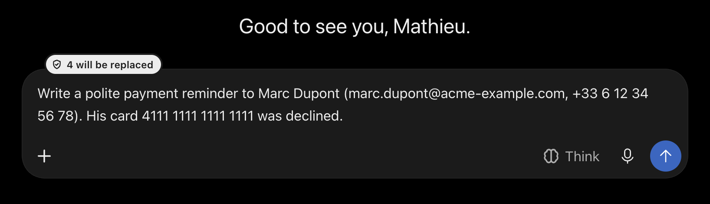
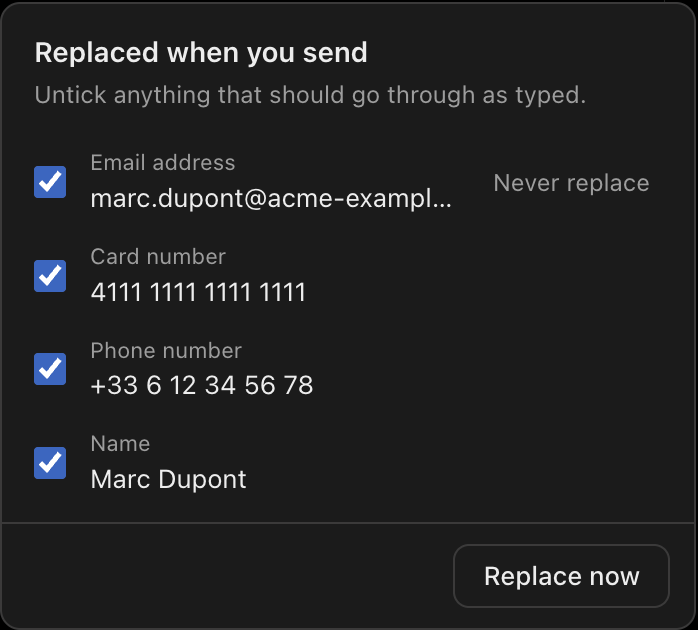
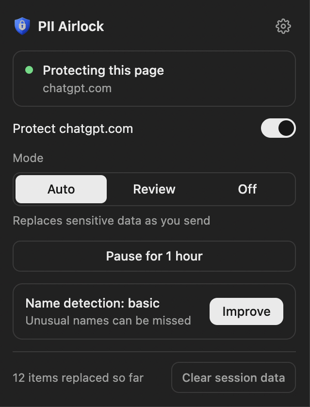
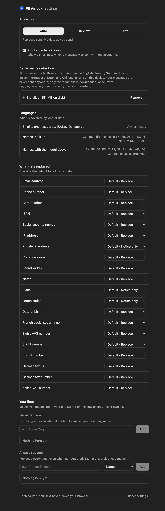

<div align="center">


# PII Airlock

**Your chats get the placeholders. You keep the secrets.**

A browser extension that swaps personal data for placeholders in AI chat messages, on your device, before you hit send.

[](https://github.com/matinfo/pii-airlock-extension/actions/workflows/ci.yml)
[](LICENSE)


Works on **Claude · ChatGPT · Gemini · Copilot · Perplexity · Mistral**

<br>



<a href="screenshots/demo_sample.mp4"><b>▶ Watch the demo (mp4)</b></a>

</div>

## Why

Everything you paste into a chatbot is sent to a third party. PII Airlock sits between your keyboard and the send button: it spots emails, phones, cards, IBANs, secrets and names, and sends `<EMAIL_ADDRESS_1>` instead. The answer comes back with your real values restored on screen.

```text
You type   Mail alice@corp.com, card 4111 1111 1111 1111
Chat sees  Mail <EMAIL_ADDRESS_1>, card <CREDIT_CARD_1>
```

- **Zero setup.** No account, no server, no API key.
- **Fail-closed.** If the check errors, the message is not sent.
- **On-device.** Your text never leaves the browser.

<div align="center">

</div>

---

## What it does

1. You type or paste a message in an AI chat.
2. A status tab on the composer shows how many items will be replaced.
3. When you send (Enter or the send button), the extension checks the text first.
4. Sensitive data is replaced with placeholders like `<EMAIL_ADDRESS_1>`, then the message is sent.
5. The chat's answer is shown with your real values put back (display only). The mapping lives in memory for the tab, never on disk.

If the check fails for any reason, the message is **not sent**. You can edit it, or explicitly send it unchecked.

---

## Modes

| Mode | Behaviour |
|---|---|
| **Auto** (default) | Structured data, secrets, names and dates of birth are replaced silently. Places, organisations and private IPs are only flagged. |
| **Review** | The same set is shown in a panel before sending; you can untick items. |
| **Off** | Nothing is checked. |

Also available: per-site off switch, "pause for 1 hour", allow/deny lists and per-entity overrides in Options.

---

## Detected PII

| Type | Example |
|---|---|
| Email address | `alice@corp.com` |
| Phone number | `+1 555 867-5309`, `+33 6 12 34 56 78`, `+41 79 367 45 67` |
| Credit/debit card | `4111 1111 1111 1111` (Luhn validated) |
| IBAN | `FR76 3000 6000 0112 3456 7890 189` |
| National IDs | US SSN, FR NIR/SIRET/SIREN, CH AHV, DE tax IDs, IT VAT |
| IP address | `192.168.1.1`, `2001:db8::1` |
| Crypto address | `0x742d35Cc...`, `1A1zP1eP5...` |
| Secrets | `Bearer eyJ...`, `sk-...`, `ghp_...`, `password: ...` |
| Person name | `Alice Johnson` |
| Location, organisation | `San Francisco, CA`, `Acme Corp` (flagged, not replaced by default) |
| Date of birth | `DOB: 01/15/1985` (contextual only) |

Names use two layers: a fast built-in English lexicon, and an optional on-device model (Options → "Better name detection") that is multilingual and catches unusual surnames and non-English first names.

---

## Languages

| What | Coverage |
|---|---|
| Emails, phones, cards, IBANs, national IDs, secrets | Any language (pattern based; phone numbers are matched by region) |
| Names, built-in | Common first names in English, French, German, Italian, Spanish, Portuguese, Dutch. Not Russian, Japanese or Chinese. |
| Names, with the optional model | English, French, German, Spanish, Italian, Portuguese, Dutch, Chinese (also Arabic, Latvian). Catches unusual surnames. |
| Interface | English, French, German, Spanish, Italian (Spanish and Italian are drafts awaiting native review) |

The same table is in the extension's Settings page.

<div align="center">

&nbsp;

</div>

---

## Supported sites

Verified on the live site:

- chatgpt.com
- claude.ai
- gemini.google.com
- copilot.microsoft.com, copilot.cloud.microsoft
- perplexity.ai
- chat.mistral.ai (Le Chat - Vibe)

Other sites are not supported: the extension does not run on them, and requests no permission for them. Adapters for Poe, Character.ai, Hugging Face Chat and You.com exist in the code but are not shipped until they have been verified in a real browser.

---

## Privacy

- **Your text never leaves your device.** Detection runs locally. There is no analytics and no remote service.
- **One optional download.** If you turn on better name detection, the extension downloads the model once from a pinned Hugging Face revision, verifies its SHA-256 and stores it in the browser cache. Nothing else is fetched, and your text is never part of that request.
- **No raw PII on disk.** Placeholder mappings live in memory, mirrored per tab in `storage.session` (RAM only, dropped when the browser closes). Settings sit in `storage.sync`. Your own allow/deny lists and the counter stay in `storage.local`, never synced. "Clear session data" wipes them.
- **Minimal permissions.** `storage`, `scripting` (Chrome/Edge: starts protection in tabs already open at install/update) plus the host patterns of the supported sites above. No `<all_urls>`.

---

## Known limits

- It reduces risk, it does not remove it: detection cannot guarantee 100% recall, especially for names without the optional model.
- File attachments, voice input and screenshots are not covered.
- Site UIs change. A redesign can break an adapter; the popup then says no composer was found instead of claiming protection.
- Showing your real values in the chat's answers is display only, but it happens in the page's DOM: the chat site's own scripts could read those values there. The message that is *sent* only ever contains placeholders.
- The chat's own "Copy" button copies placeholders, not your real values. Old chats reopened after a browser restart show placeholders.

---

## Development

```bash
bun install
bun run dev            # Chrome with HMR (dev:firefox, dev:edge also exist)
bun run build          # Chrome → .output/chrome-mv3/ (build:firefox, build:edge, build:all)
bun run compile        # type-check
bun test tests         # unit tests
bun run e2e            # real-browser tests (Playwright)
bun run zip            # package for store submission (zip:firefox, zip:edge, zip:all)
```

### Building from source (store reviewers)

Requirements: Linux or macOS, [Bun](https://bun.sh) 1.3.14 (pinned in `package.json`), Node not needed.

```bash
bun install --frozen-lockfile
bun run zip:firefox    # → .output/pii-airlock-extension-<version>-firefox.zip
```

The build output is the Firefox package. The ONNX Runtime files in `public/wasm/`
(`ort-wasm-simd-threaded.{mjs,wasm}`) are copied unmodified from the pinned
`onnxruntime-web` npm package by `scripts/fetch-ner-assets.ts` during the build.
The names model is never packaged; it is an opt-in download (see PRIVACY.md).

Architecture, invariants and the checklist for adding a site are in [CLAUDE.md](CLAUDE.md).

---

## Privacy, security, license

- [PRIVACY.md](PRIVACY.md): what is stored and the one optional network request.
- [SECURITY.md](SECURITY.md): how to report a vulnerability.
- [MIT License](LICENSE).

---
